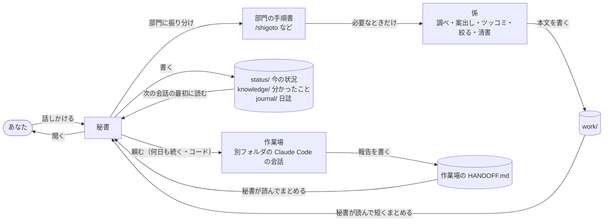

# 入口を「秘書」ひとつにする理由

AI（Claude など）をもう毎日使っている人向けの説明です。はじめかたは [README](../README.md) にあります。

## 3行で
- Claude Code の会話を、あちこちのチャットや窓に散らさず、**秘書ひとつ**に集める
- 秘書は毎回**ファイル**を読んでから答えるので、前の話を説明し直さなくていい。会話は消してもいい
- 秘書が**聞かずにやること**と**必ず聞くこと**が、最初から決めてある
- 何日も続く作業やコードを書く作業は、秘書が**作業場**（別のフォルダの Claude Code の会話）に頼んで、報告をまとめる。あなたが会話やフォルダを行き来しなくていい

## 前と後

| | 前（よくある使い方） | 後（このテンプレート） |
|---|---|---|
| 話す相手 | 用事ごとに新しいチャット・窓・セッション | 秘書ひとつ。用事は秘書が「部門」に振り分ける |
| 前の話 | チャットの中に埋もれる。毎回説明し直す | 秘書がファイル（`status/`）に書く。次の会話は最初にそれを読む |
| 締め切り | 自分で覚えておく | 会話を始めるたびに「7日以内の予定」が最初に出る |
| 案を比べる | 1つの会話で何度も頼み直す | 秘書が「係」を呼び、案を出す係・ツッコむ係・絞る係に分けて比べる |
| 許可の画面 | 何でも聞かれる／何でも通してしまう | 自分のメモへの書き込みは聞かれない。お金・外に出ること・指示書の変更だけ聞かれる |
| 長い会話 | 重くなって、どこまで話したか分からなくなる | `/kugiri` で大事なことをファイルに保存してから消す |
| しくみのゆるみ | 「今後聞かない」で増えた許可や、終わらない依頼に気づかない | 月1回 `/tenken`（点検）で秘書が見て、あなたがやることをまとめる。設定の1行ずつの意味は `org/design.md` の「なぜこの設定か」 |
| アプリ・ツールづくり | プロジェクトごとの会話を自分で行き来して、それぞれに説明し直す | 秘書に話すだけ。秘書が作業場の会話を立てて頼み、報告（作業場の `HANDOFF.md`）を読んで「進んだこと・あなたに聞きたいこと」をまとめる |

## 図：話はひとつの入口から入り、結果はファイルに残る

- **秘書**：あなたが話す唯一の相手。このフォルダの `CLAUDE.md` が秘書への指示書
- **部門**：仕事・暮らし・お金 など、あなたの生活の分け方（`/hajime` で決める）。部門ごとに「今の状況」の1枚（`status/<部門>.md`）がある
- **手順書**：部門ごとの「秘書の動き方メモ」。`/shigoto` のように打って呼べる（作るかは任意）
- **係**：秘書が必要なときだけ呼ぶ手伝い役。呼ばれて、結果をファイルに書いて、消える。係同士は話さない
- **作業場**：何日も続く作業・コードを書いて動かす作業の場所。あなたのアプリやツールのフォルダで動く、別の Claude Code の会話。秘書が立てて頼み、報告は作業場の `HANDOFF.md` に書かせる（下の節）
- **ファイルに残る**：秘書が書いたものは Git（ファイルの変更を全部覚えておく道具）で保存され、GitHub（自分だけが見られる置き場）に送られる。前の版にも戻れる

## 1日の使い方の例

| とき | あなた | 秘書 |
|---|---|---|
| 朝、会話を開く | — | 「家賃の振り込み、あと2日です」と先に言う |
| 休み時間 | 「来週の飲み会、店の候補を3つ」 | 調べて3つ出す。決めるのはあなた（スマホから話す方法は README の「開発中」の節） |
| 昼 | 「資格の過去問、どこが弱い？」 | 前に書いた進み具合（`status/資格の勉強.md`）を読んで答える |
| 夕方 | 「家計簿アプリ、グラフを月ごとにしたい」 | 作業場（家計簿アプリのフォルダ）の会話に頼む。あとで報告を読み、「できた。色を2案から選んでほしい。A がおすすめ（見分けやすいから）」とまとめる |
| 夜 | 「洗濯」と1行だけ打つ | 記録して「記録しました」とだけ言う（記録のボタンを使う人だけ） |
| 寝る前 | `/kugiri` | 今日決まったことをファイルに書いて保存し、「消して大丈夫」と言う |

## 作業場：ほかのフォルダの作業も、秘書に頼むだけ
アプリやツールを Claude Code で作っている人は、いちばん効く所。

- **作業の3つの置き場所**：1回で終わる頭の仕事（調べもの・案出し）は**係**／何日も続く・コードを書いて動かす作業は**作業場**／手と体が要ること（買い物・電話）は**あなた**。どれも入口は秘書
- **秘書が作業場の会話を立てて頼む**。立てる前に「新しい会話にしますか」の確認が出るので、そこであなたが OK する。1つの作業場に会話は1つ（同じフォルダに2つの会話から書くと、ぶつかるため）
- **報告は作業場の `HANDOFF.md` に残る**（今どこ・決めたこと・あなたに聞きたいこと）。秘書は次の会話の最初にそれを読んで、短くまとめて言う。秘書の会話を消しても、報告はなくならない
- **作業場があなたに聞くことには、おすすめ1つと理由1行が付く**（秘書が頼むときにそう書く）
- **秘書は作業場の中を書きかえない**。書くのはその作業場の会話だけ。秘書は台帳（`status/<部門>.md` の「## 台帳」）に、場所・何か・今どこ・次の一手を書いて見張る
- **秘書に作業場を読ませるには**、あなたが1回だけ1行を打つ：`powershell -ExecutionPolicy Bypass -File .\setup.ps1 -AddFolder "<フォルダ>"`（秘書のフォルダの中で。足す前に聞かれる）。`/hajime` でも案内される
- 右の組織図（soshiki-zu）には、秘書が立てた作業場の会話が「動いている／止まっている」で出る
- 作業場を立てるのは、Claude のデスクトップアプリの Code で使っているときだけできる

## 何が自動で、何を聞かれるか

| 聞かれない（自動） | 必ず聞かれる | できない（止めてある） |
|---|---|---|
| ファイルを読む・調べる・下書き・計算 | お金が出ること（買い物・申し込み） | ファイルを消す・保存した履歴を書き換える |
| 自分のメモ（status・knowledge・journal など）に書く | 外に出ること（メール・投稿・人への連絡） | 秘書が自分の設定・係の決まりを変える |
| 保存（Git の commit と push） | 秘書の指示書（`CLAUDE.md`）と手順書を変える | `curl`・`wget` でネットから取ってくる命令（Web で調べて読むことはできる） |
| 会話の最初に予定を出す・記録を書く（フック＝決まったときに自動で動く小さなプログラム） | 消してよいか（例の部門を消すときなど） | |
| 作業場の報告（HANDOFF.md）を読んでまとめる | 作業場の会話を新しく立てる | 秘書が作業場の中のファイルを書きかえる |

選んでもらう質問には、秘書がおすすめを1つと理由を1行付けます。

## できないこと・向かないこと
- **Windows だけ**：会話の最初に予定を出すしくみが PowerShell（Windows の命令の道具）で書いてある
- **有料プランが要る**：Claude の Pro 以上。無料では Claude Code が使えない
- **秘書は作業場の中を書きかえない**：コードを書くのは作業場の会話。秘書は頼む・読む・まとめるだけ。読めるのは、あなたが `-AddFolder` で足したフォルダだけ
- **会話の中身はファイルにしか残らない**：秘書がファイルに書かなかったことは、次の会話では知らない。大事なことは「書いておいて」と言うか `/kugiri`
- **向かない**：数分で終わる1回きりの質問（ふつうのチャットで十分）／いま画面を見ながら1行ずつ直したいとき（作業場の会話を開いて、直接話すほうが速い。終わったら秘書に「○○の作業場、ここまで進んだ」と言えば台帳に残る）／お金や健康の判断そのもの（秘書は材料をそろえるまで）

## ことばの一言説明
- **Claude Code**：Claude がファイルを読み書きしながら作業できるモード。Claude のデスクトップアプリの「Code」
- **セッション**：Claude Code の1つの会話。左の一覧に並ぶ。秘書の会話も、作業場の会話も、それぞれ1つのセッション
- **HANDOFF.md**：作業場が「今どこ・決めたこと・聞きたいこと」を書いておくファイル。秘書はこれを読んで報告をまとめる
- **`/○○`**：入力欄に打つ「手順書を呼ぶ合図」。`/hajime`（はじめの設定）・`/kugiri`（区切り）など
- **Git・commit・push**：ファイルの変更を覚えておく道具・その場で保存すること・GitHub に送ること
- **フック**：決まったとき（会話を始めたとき・1行打ったとき）に自動で動く小さなプログラム
- **プラグイン（MOD）**：Claude Code に足す追加機能。組織図（soshiki-zu）や記録のボタン（kiroku-botan）
